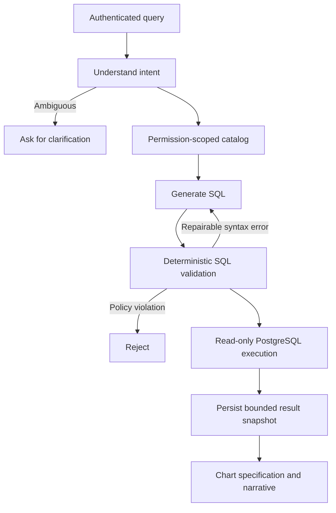

# Secure SQL Analytics

A runnable FastAPI + LangGraph + PostgreSQL + Streamlit upgrade to the original
multi-state SQL agent. The original prototype remains in the repository root.

The LLM proposes queries; deterministic validation and database roles enforce access.
This implementation is a production-oriented reference, not a claim that it has been
deployed, penetration-tested, or load-tested in your environment.

## Run locally (Windows + Docker Desktop / WSL, macOS, or Linux)

From this directory, with Python 3.12+ and Docker Compose installed:

```bash
python scripts/init_demo.py
docker compose up --build
```

Open **http://localhost:8501**. API documentation is at **http://localhost:8000/docs**.
The first image build downloads pinned dependencies. No LLM API key is needed for demo mode.
Only localhost ports are published. PostgreSQL remains inside the Compose network.

Try `total revenue`, `monthly revenue`, or `revenue by category`.
Demo mode is a deterministic test double, not an LLM: other wording may be simplified
to those templates. Switch to a real provider for open-ended natural-language queries.

| Demo identity | Visible completed revenue | Export behavior |
|---|---:|---|
| analyst-north | INR 300 | Requires an independent approval |
| manager | INR 1,000 | Can review another user's request in tenant A |
| other-tenant | INR 9,000 | Isolated tenant B; cannot review tenant A requests |
| viewer | INR 300 | Cannot request exports |

Export walkthrough: query as `analyst-north`, request approval, switch to `manager`,
approve under Export approvals, switch back, submit the same question if needed,
or use the original run ID through the API to fetch the approved CSV. Changing the
UI identity clears its session data; the original saved run remains accessible by API.

Stop services with `docker compose down`. Data survives in a named volume.
`docker compose down -v` deliberately deletes the local demo database.

## Use a real model

For your local Ollama model, update the generated `.env`:

```dotenv
MODEL_PROVIDER=ollama
MODEL_BASE_URL=http://host.docker.internal:11434/v1
MODEL_NAME=llama3.1:8b
```

Run `ollama pull llama3.1:8b` on the host and ensure Ollama accepts connections from
the Docker network. Then run `docker compose up -d --force-recreate api`.
The service requires JSON outputs that pass Pydantic validation. Model capability
varies; evaluate your selected model with your business questions.

For Azure, use `MODEL_PROVIDER=azure`, `AZURE_ENDPOINT`, `AZURE_API_VERSION`,
`MODEL_NAME` (deployment name), and `MODEL_API_KEY`. For the OpenAI-compatible
provider use `MODEL_PROVIDER=openai`, `MODEL_BASE_URL`, `MODEL_NAME`, and
`MODEL_API_KEY`. The SDK retries are disabled; the application counts and limits
all attempts, including transient retries.

## Entra authentication and production deployment

Read [deployment.md](docs/deployment.md) before deploying. Production mode rejects
demo authentication, the demo model, and PostgreSQL DSNs without `sslmode=verify-full`.
The included Compose file is a **local development stack**, not an Azure provisioning tool.
No real tenant, cloud service, API key, or production dataset is embedded in this repo.

Authentication validates RS256 signatures, issuer, audience, expiry, not-before,
identity tenant, and delegated API scope. App-only tokens are deliberately unsupported.
Authorization is resolved from administrator-provisioned database records on every
request. The model and the caller cannot grant themselves a role or a tenant scope.

## Workflow



The graph has four LLM responsibilities: intent, SQL generation, chart planning,
and narrative generation. Schema selection, authorization, SQL validation, execution,
ownership, approvals, and chart rendering are deterministic.

## API

All `/v1` endpoints require `Authorization: Bearer <API access token>`.

| Method | Endpoint | Permission |
|---|---|---|
| POST | `/v1/queries` | `analytics:query`; UUID `Idempotency-Key` header |
| GET | `/v1/queries/{run_id}` | Query owner + `analytics:query` |
| POST | `/v1/queries/{run_id}/resume` | Query owner + `analytics:query` |
| POST | `/v1/queries/{run_id}/export-request` | Query owner + `analytics:export` |
| GET | `/v1/queries/{run_id}/export` | Query owner + export permission + approval |
| GET | `/v1/approvals` | `approvals:review` within the business tenant |
| POST | `/v1/approvals/{approval_id}` | Independent tenant reviewer |
| GET | `/v1/me` | `analytics:query` |
| GET | `/metrics` | `operations:metrics` |

Example request body: `{"question":"Show monthly revenue"}`.
Approval body: `{"approved":true}` or `{"approved":false}`.
For a local API token: `docker compose exec api python scripts/demo_token.py analyst-north`.
Tokens expire after 15 minutes; never put them into source files or logs.

## Guarantees and deliberate limits

- PostgreSQL RLS uses scoped database roles, not a caller-controlled session variable.
- The query gateway login has `NOINHERIT`; every query gets a transaction-local role.
- Schema/table grants and RLS remain active even if the model generates an incorrect filter.
- PII columns are absent from the curated analytics schema. Dataset access is provisioned
  per principal; this version uses a fixed safe column catalog, not arbitrary per-user columns.
- Only one simple SELECT is accepted. Joins, grouping, approved aggregates, sorting and
  filters are supported. CTEs, subqueries, UNION, windows, arbitrary functions, `SELECT *`,
  DDL, DML, locks and system catalogs are rejected. Expand this subset with security tests.
- SQLGlot validation is one layer, not a complete SQL sandbox. The runtime DB roles,
  a dedicated analytics database, statement timeout, and restricted network are essential.
- Parameters for application metadata are bound. Generated analytical SQL is parsed and
  regenerated as a whole; it does not claim that binding arbitrary SQL makes it safe.
- Result rows and bytes are bounded. `LIMIT` does not bound scan/join cost; provision a
  reporting database and tune indexes for your real workload.
- A durable result snapshot is reused on replay. A crash after SELECT but before snapshot
  persistence can repeat the read against newer data. There is no exactly-once read claim.
- Export approvals expire after one hour and bind the result digest and authorization
  fingerprint. Self approval is rejected. CSV downloads are idempotent and escape formulas.
- Approval gates the export endpoint, not the user's ability to copy data they can already
  view. Stronger data-loss prevention needs additional organization controls.
- Checkpoints and snapshots contain sensitive questions/SQL/data. Protect and expire them.
- Narratives are model-generated and may be wrong; authoritative rows and assumptions
  remain visible. No generated Python is executed.
- This version handles independent questions. Clarifications are submitted as a new query;
  it does not infer context across arbitrary conversations.

## Testing

```bash
python -m venv .venv
# Windows PowerShell: .\.venv\Scripts\Activate.ps1
# Linux/macOS: source .venv/bin/activate
pip install -r requirements.lock
pip install --no-deps -e .
python -m pytest -q -m "not integration"
python -m ruff check sql_analytics scripts ui tests
```

For integration tests, point the four DSNs at a disposable PostgreSQL 16 database,
set `ENVIRONMENT=test`, `AUTH_MODE=demo`, `MODEL_PROVIDER=demo`, and the passwords,
then run `python scripts/bootstrap.py --demo`. Set `RUN_DATABASE_TESTS=1` and run
`python -m pytest -q`. The GitHub workflow provisions this environment automatically.

Tests cover malicious SQL, JWT tampering, cross-tenant/region isolation, ownership,
idempotency, independent export approval, policy revocation, and checkpoint recovery.
See [security.md](docs/security.md), [operations.md](docs/operations.md), and
[evaluation.md](docs/evaluation.md) for release and operations procedures.

## Layout

| Path | Purpose |
|---|---|
| `sql_analytics/main.py` | API, lifecycle, deadlines, replay, and observability |
| `sql_analytics/auth.py` | API token validation and permission dependencies |
| `sql_analytics/workflow.py` | Stateful LangGraph orchestration |
| `sql_analytics/sql_guard.py` | Fail-closed SQL AST validation |
| `sql_analytics/executor.py` | Restricted read-only database execution |
| `sql_analytics/store.py` | Ownership, snapshots, budgets, audit, and approvals |
| `sql_analytics/catalog.py` | Versioned business definitions and safe schema |
| `sql_analytics/llm.py` | Provider adapters, retry budget, and demo model |
| `sql/` | Database schema, RLS policies, synthetic data |
| `scripts/` | Administrative provisioning and local setup |
| `ui/app.py` | Streamlit sign-in, results, charts, and approvals |
